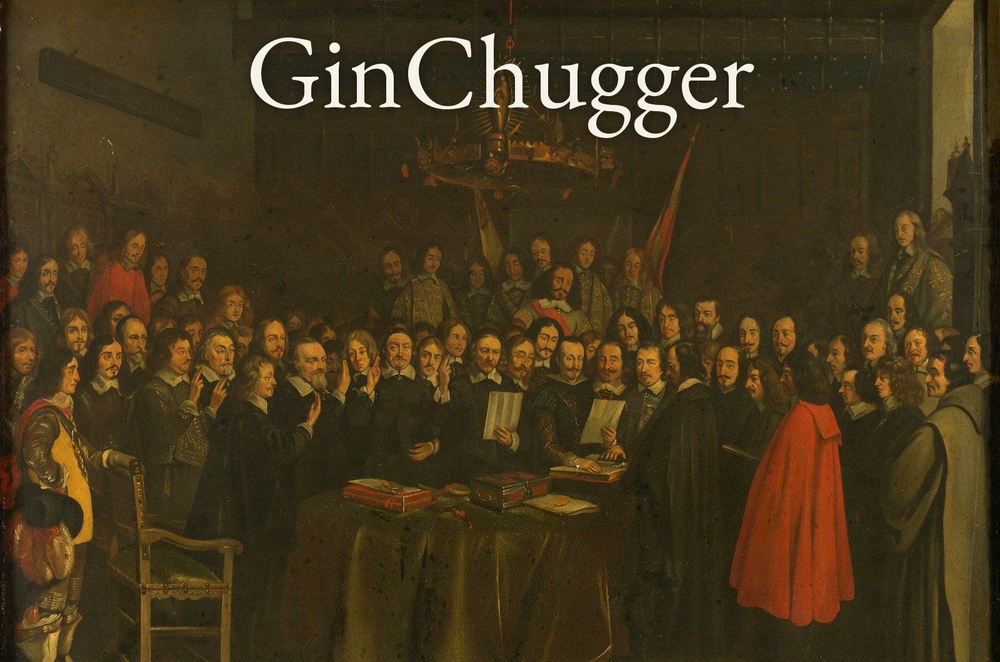
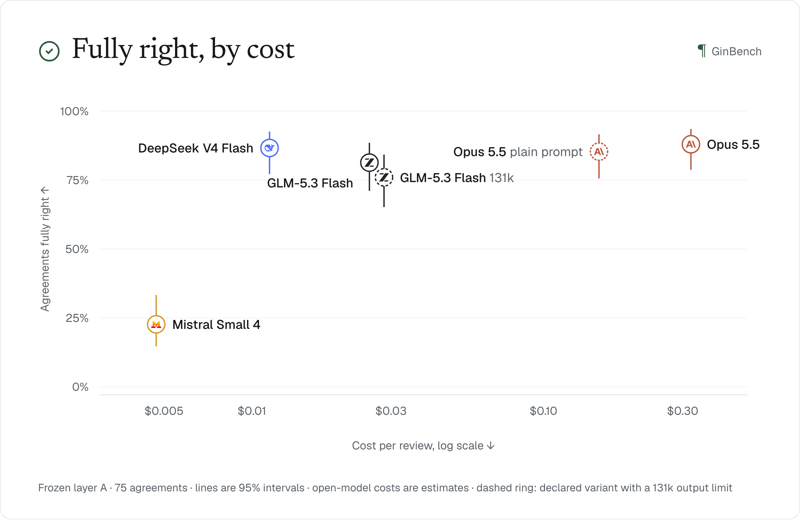
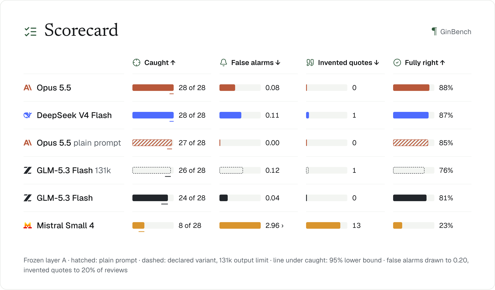
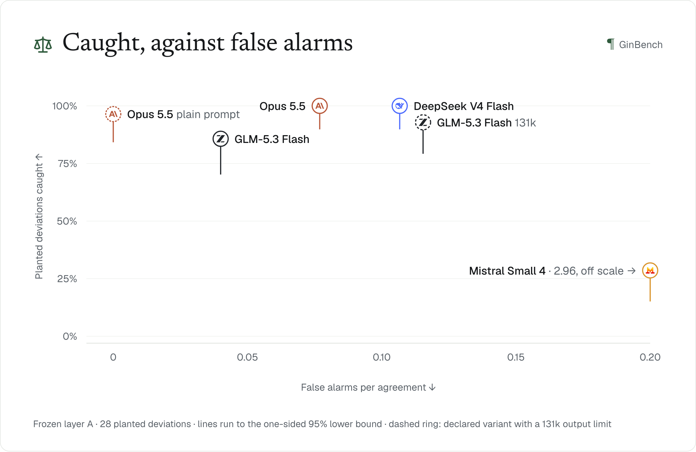
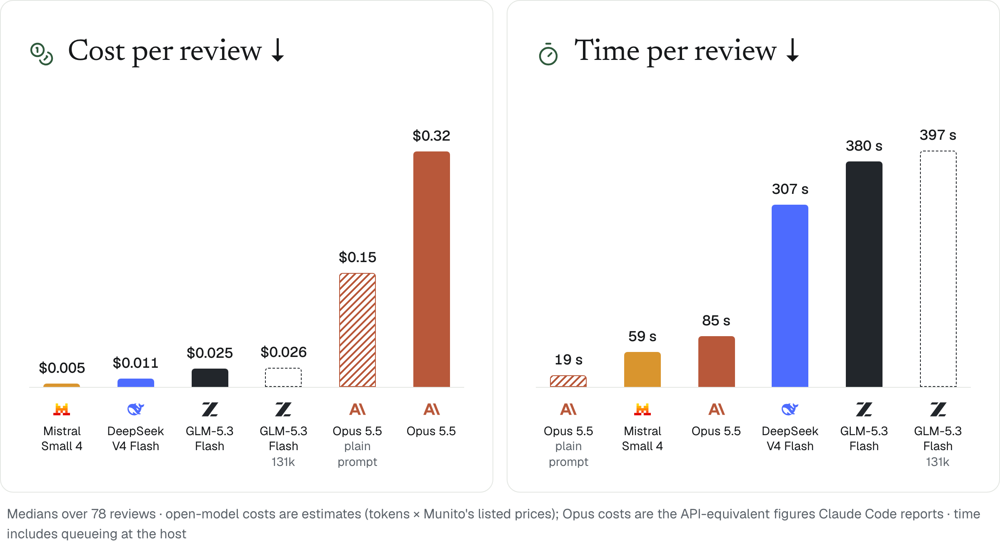
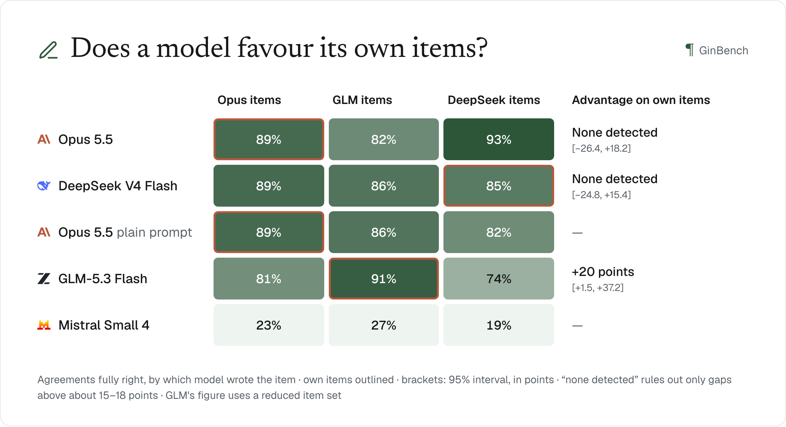
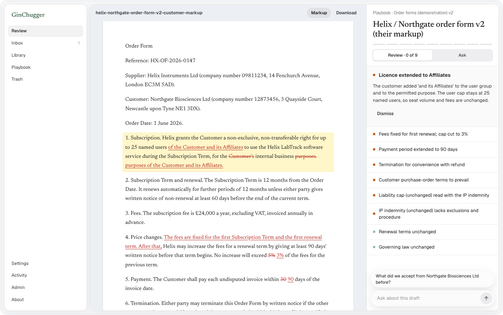
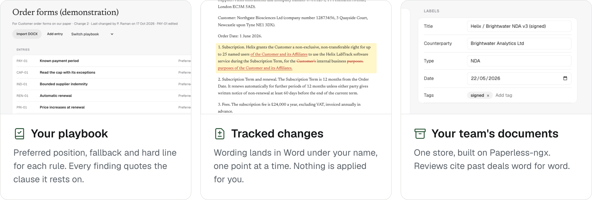

<p align="center">Contract review in Word, against your own playbook, and the benchmark that measures it.</p>

<p align="center"><a href="#ginbench">Results</a> · <a href="#the-app">The app</a> · <a href="#run-it">Run it</a> · <a href="docs/README.md">Docs</a></p>

<br>

## GinBench

How often does a model miss a departure from your playbook, raise a false alarm, or invent a quote? GinBench plants deviations in Common Paper agreements and runs the same review code a lawyer uses in Word.

<picture>
  <source media="(prefers-color-scheme: dark)" srcset="docs/readme/fully-right-by-cost-dark.png">
  
</picture>

Opus 5.5 and DeepSeek V4 Flash get about 9 in 10 agreements fully right. DeepSeek, served from the EU, costs about a cent a review; Opus about 32 cents.

<picture>
  <source media="(prefers-color-scheme: dark)" srcset="docs/readme/scorecard-dark.png">
  
</picture>

<details>
<summary>More results: caught against false alarms, cost and time, own-item advantage</summary>
<br>

<picture>
  <source media="(prefers-color-scheme: dark)" srcset="docs/readme/caught-vs-false-alarms-dark.png">
  
</picture>

<picture>
  <source media="(prefers-color-scheme: dark)" srcset="docs/readme/cost-and-time-dark.png">
  
</picture>

<picture>
  <source media="(prefers-color-scheme: dark)" srcset="docs/readme/own-items-dark.png">
  
</picture>

</details>

<sub>Frozen layer A (tag <code>bench-v2.0-a</code>), one run per setup. Open-model costs are estimates from tokens and listed prices. No lawyer has validated the items or answer keys. <a href="tough-eval/RESULTS.md">All results</a> · <a href="tough-eval/BENCHMARK-V2.md">Method</a></sub>

<br>

## The app

Reviews a contract against your playbook inside Word, proposes wording as tracked changes, and reads what your team agreed with the same counterparty before.



<picture>
  <source media="(prefers-color-scheme: dark)" srcset="docs/readme/features-dark.png">
  
</picture>

<br>

## Run it

```sh
cd contract-review
npm install
npm run build
npm start
```

Open http://localhost:3000 and choose a model in Settings. Node.js 22 or later; the document store runs in Docker, or in memory without it. [Full setup](contract-review/docs/SETUP.md)

<br>

---

<sub>A prototype. No lawyer has validated its output, its playbooks or the benchmark, and nothing here is legal advice. [Limits](docs/LIMITS.md) · [Docs](docs/README.md) · [Credits](NOTICE.md) · GPL-3.0-or-later</sub>
