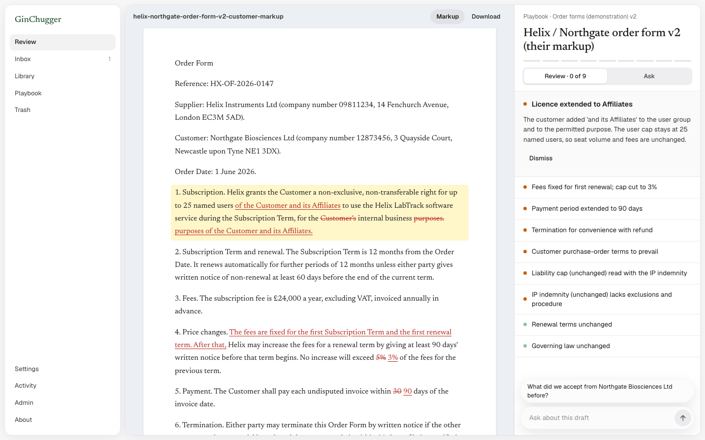

# GinChugger and GinBench

**GinChugger** is a prototype contract-review tool for a small in-house legal team. It reviews routine commercial paper (NDAs, SaaS agreements, data processing agreements, order forms) against the team's own playbook, inside Word, and proposes wording the lawyer can apply as a tracked change. The team's documents live in one document store ([Paperless-ngx](https://github.com/paperless-ngx/paperless-ngx), run unmodified as a separate local service), so a review can read what the team accepted from the same counterparty last time.

**GinBench** is the benchmark built alongside it. It asks one question: when a model reviews routine commercial paper against a stated playbook, how often does it miss a departure, raise a false alarm or invent something? It runs the same review code a lawyer uses in Word, so its numbers describe the product rather than a lab copy of it.

Status: **prototype**. No lawyer has validated the app's output, the playbooks, or the benchmark's items and answer keys. Every finding is a prompt for a lawyer's judgement, never a substitute for it. Nothing here is legal advice.



## What is in this repository

| Path | What it is |
|---|---|
| [`contract-review/`](contract-review/) | The app: Node.js server, React pages, the Word task pane, the team server, tests (unit, end to end against a fake of Word's API, and a stress harness in `tests/stress/`). [Setup](contract-review/docs/SETUP.md) goes from a fresh machine to a first review. |
| [`tough-eval/`](tough-eval/) | GinBench: the specification ([`BENCHMARK-V2.md`](tough-eval/BENCHMARK-V2.md)), the runner and scorers, the public data it is built on, the base documents and playbooks, and the reports. The folder keeps its working name until the next benchmark version, because the frozen benchmark's file hashes are keyed on its paths. |
| `common-paper-notes.md`, `benchmark-self-bias-research.md` | Short sourced notes the playbooks and the specification cite. |
| [`NOTICE.md`](NOTICE.md), [`LICENSE`](LICENSE) | Where code, data and ideas come from; GPL-3.0-or-later. |

Some files say "run from `outputs/`": in this repository that is the top-level folder, the one that holds `contract-review/` and `tough-eval/`.

## What the app does

- **Reviews a contract against your playbook.** Each rule has a preferred position, what you would accept, what needs escalating, and your hard line. Each finding quotes the exact wording it relies on and names the rule. Code checks the quote against the document; a quote that is not there is flagged, not hidden.
- **Proposes wording you can apply in Word** as a tracked change under your own name, one point at a time. There is no Apply All. A dismissed point records whether it was not an issue or their wording was accepted; the second is kept as a note on the document, so a later review can see the concession.
- **Keeps the team's documents in one store**, filed under a counterparty, a type, tags and a date, with full-text search. During a review the model can read those documents through four read-only tools, and whatever it quotes from them is checked word for word. Text from the store reaches the model marked as untrusted.
- **Lets the team choose the model**: the lawyer's own Claude Code login, an Anthropic API key, or any OpenAI-compatible host. There is no demo mode; every review is a real model call.
- **A team server** (optional, Docker) holds shared playbooks, people and single-use setup codes, serves the team store, and can capture contract attachments from a shared mailbox into the Inbox. It never sends text to a model, and refuses to start if it finds an AI credential.

More: [`contract-review/README.md`](contract-review/README.md), [For IT and security teams](contract-review/docs/FOR-IT.md), [Word setup](contract-review/docs/WORD.md), and the [verification record](contract-review/docs/VERIFICATION.md), which lists what has and has not been checked by a person.

## Try it

You need Node.js 22 or later and a model route of your own. The document store is Paperless-ngx in Docker (the first start pulls about 6.6 GB of images); without Docker the app uses a built-in, in-memory store and says so in one line (`GCL_STORE=fake` asks for it explicitly).

```sh
cd contract-review
npm install
npm run build
npm start
```

Open http://localhost:3000. Until a model route works, the Review screen says "No model set up yet · Settings · Models". Under **Settings · Models** choose your Claude Code login (start the app from a terminal where `claude` is signed in), an Anthropic API key, or an OpenAI-compatible host. Then **Review → Open**, choose `data/fixtures/order-form/helix-northgate-order-form-v2-customer-markup.docx` and press **Review**. Keys entered in Settings go in the Mac Keychain or Windows Credential Manager. Read your model provider's terms before sending it any real document. The team server, the Word add-in and the release builds are covered in [`contract-review/docs/`](contract-review/docs/).

Tests (no model is called):

```sh
cd contract-review
REVIEW_EXECUTOR=refuse-live npm test      # unit and integration; any live model call fails the test
npm run test:e2e                          # end to end, against a fake of Word's API (a fake is not Word)
npm run stress                            # concurrent workflows against its own servers and a stub model

cd ..
node --test tough-eval/arms/*.test.mjs tough-eval/baselines/*.test.mjs tough-eval/v2/*.test.mjs tough-eval/v2/tests/*.test.mjs tough-eval/v2/layer-c/tests/*.test.mjs
node tough-eval/selftest.mjs              # the v1 scorer against synthetic reviewers with known answers
node tough-eval/contractnli/selftest.mjs  # the same for layer B
```

The benchmark tests import the app's code, so run `npm install` in `contract-review/` first. One test that needs the held-back items skips. The end-to-end tests use fixed ports (3197, 3291, 3292) by default; set `E2E_PORT_OFFSET` if those are taken.

## GinBench

GinBench v2 has four layers, reported separately and never merged into one score:

- **A. Planted deviations.** Edits planted in Common Paper's public agreements (CSA and Mutual NDA, both sides of each), beside harmless edits that should not be flagged. Three model families wrote the items; each item was checked by the two families that did not write it.
- **B. Real NDAs.** The ContractNLI test split (123 NDAs), with the dataset's published labels mapped to a playbook.
- **H. History.** Scenarios in which the reviewer must use the store correctly: cite precedent, refuse bait concessions, ignore the wrong counterparty, ignore instructions injected into documents.
- **C. Attorney fixes.** Three tasks adapted from RedlineBench, judged by two model judges against attorney redlines.

Code scores layers A, B and H against an answer key. A review with an invented quote fails. Results are an error profile per setup with confidence intervals; there is no pass mark.

**Results.** [`tough-eval/v2/RESULTS-2026-10-17.md`](tough-eval/v2/RESULTS-2026-10-17.md) is the summary. Layer A has a first frozen run at the tag `bench-v2.0-a` ([`frozen/REPORT.md`](tough-eval/v2/frozen/REPORT.md)): on its 28 verified single deviations Opus 5.5 and DeepSeek V4 Flash with the product prompt missed none, and with so few items that means "fewer than about 1 in 9" at 95% confidence, not zero. GLM-5.3 Flash missed 4 (with the fewest false alarms) and Mistral Small 4 missed 20; a declared GLM variant with twice the output budget, reported beside the frozen result, missed 2. Layers H, B and C are preliminary, from a run before the freeze ([`prelim/REPORT.md`](tough-eval/v2/prelim/REPORT.md), [`PRELIMINARY-WRITEUP-2026-10-17.md`](tough-eval/v2/PRELIMINARY-WRITEUP-2026-10-17.md), and the audit of layers B and C in [`analysis/audit-B-C-2026-10-17.md`](tough-eval/v2/analysis/audit-B-C-2026-10-17.md)).

**The app and the frozen benchmark.** The frozen layer A runs used the app as it was at `bench-v2.0-a`. The app here has moved on since: `contract-review/server/review.js`, `server/executors.js`, `server/store/tools.js`, `server/store/text.js` and `package.json` differ from the frozen hashes (Ask's live progress, reviews that no longer block the app and can be stopped, and the security fixes). The review's request to the model is unchanged since the tag (same prompt, payload and CLI flags), and `contract-review/tests/review-nonblocking.test.js` pins it. That tag is in the project's private history, not in this repository, so the frozen runs cannot be re-run from this snapshot as is; a re-run here would be a new benchmark version. `node tough-eval/v2/check-frozen.mjs` lists the changed files and the held-back ones.

**v1.** The earlier v1 suite (one Common Paper CSA, plus a 60,000-character bundle, items written by one model) is still in `tough-eval/` as GinBench v2's development set. It is published whole, including the 24 cases its `split.json` marks as held out: their plant definitions are in v1's generator (`build.mjs`, `build-bundle.mjs`) and manifests, which the frozen runner reads, and held-out plants also appear inside v1's development markups by design, so leaving out the 24 variant files would hide nothing. v1 is superseded and none of its held-out results is claimed anywhere.

## What is held back, and why

Publishing the test items before the frozen results are complete would let anyone (or any model trained on this repository) see the answers. These parts are **not included yet**, and will be published together with the frozen results:

- **Layer A test items:** `tough-eval/v2/items.json`, `markups.json`, `manifest.json`, `inserted-checks.json` (per-item accept checks), `variants/`, `authoring/`, `verification/`; the contested-item list `ERRATA.md`; and the two item-level error analyses (`v2/analysis/opus-errors-2026-10-17.md`, `v2/analysis/open-models-errors-2026-10-17.md`), which quote planted wording.
- **Layer H scenarios:** `tough-eval/v2/scenarios/`, `verification-scenarios/`, `scenarios-manifest.json`.
- **Development authoring runs and the preliminary item snapshot:** `tough-eval/v2/dev/` (one development item matches a test item) and `tough-eval/v2/prelim/snapshot-*`.
- **Raw model outputs and logs:** `tough-eval/runs/`, `tough-eval/results/`, the run logs and the raw calibration outputs (the calibration summaries are included). Layer A and H runs embed the held-back items.

[`tough-eval/v2/frozen.json`](tough-eval/v2/frozen.json) records the SHA-256 of every file the frozen layer A result depends on, held-back items included. Once they are published, `node tough-eval/v2/check-frozen.mjs` checks them against the hashes committed here.

Some documents mention files that are not in this repository: the held-back files above, and the project's working notes (a results ledger, a decision log, task reports). The preliminary write-up and the results summary cite the two held-back error analyses. These are plain mentions, not links, and are left as written. The app's Settings and Benchmark pages cite results-ledger entries for the same reason; one test that checks those citations skips here.

## Limits, stated plainly

- No lawyer has validated any finding, playbook, position, item or answer key. Nothing here measures time saved.
- Layer A is constructed, not real negotiations. Its items were written by three model families, one of which (Claude) is also under test; the by-author analysis did not detect a self-advantage, but it can only detect a large one.
- The frozen layer A set is small (28 verified single deviations), so a perfect score has a wide upper bound. Layers H, B and C are preliminary.
- Word has been tested by a person on a Mac only. Word for Windows, the Windows installer (built, unsigned, never run), a team server run by a team rather than by the test suite, and the screen-reader pass remain unverified ([checks still open](contract-review/docs/VERIFICATION.md)).
- Reviews and questions through the `claude`, `anthropic` and `openai` routes no longer block the app and can be stopped; the evaluation-only `codex`, `muse` and `agy` routes still block it for the length of a call.
- Security: everything listens on 127.0.0.1; another page served from localhost cannot call the API (Origin, Host and Sec-Fetch-Site are checked); API keys and the record signing key are kept out of any process the app runs. Not defended: a process running as the same user on the same computer can call the local API, as it can read the data folder. The model's store tools read as the signed-in lawyer, not only the document under review, so in team mode a prompt-injected model can read any team document that lawyer can; what it quotes is still verified and it cannot write. There is deliberately no MCP access to the store from outside a review. A red-team pass by the people building it is in [`contract-review/docs/SECURITY-REVIEW.md`](contract-review/docs/SECURITY-REVIEW.md), with regression tests in `contract-review/tests/security/`; prompt injection is mitigated, not solved, and its live measurement (`tests/security/live-injection.mjs`) is still outstanding. No independent security review has been done.
- The code still uses the earlier name "GinChugger Legal" for the install folder, the data folder, the command name and a legacy keychain entry, so an upgrade finds existing data.

## Licence and data

GPL-3.0-or-later ([`LICENSE`](LICENSE)). Some code is translated from Paperless-ngx (GPL-3.0); those files carry the source and commit in their headers, and the original Python is kept beside the translation. Third-party data keeps its own licence:

- **Common Paper** standard agreements (CSA, DPA, SLA, Mutual NDA): CC BY 4.0, adapted here; cover terms and planted edits are ours; no endorsement is implied.
- **ContractNLI** (Koreeda and Manning, 2021): CC BY 4.0; the dataset's own licence and terms are kept in `tough-eval/contractnli/data/contract-nli/`.
- **RedlineBench** (Crosby Legal and micro1): CC BY 4.0, layer C.
- **CUAD** category list (The Atticus Project): CC BY 4.0, the app's clause types.
- **Harvey LAB** (Harvey AI): MIT, a synthetic NDA playbook used as a test fixture.

[`NOTICE.md`](NOTICE.md) has the full list, including the Docker images the store runs and the designs credited as ideas. npm dependencies keep their own licences. The parties, people and negotiations in the app's fixtures and the benchmark's scenarios are fictional; the NDAs in ContractNLI are real public documents from that dataset.

## How it was made

The app and the benchmark were built with heavy use of AI coding agents. Models from several families wrote and cross-checked the benchmark items, as the specification describes. This repository is a snapshot without the project's history.
