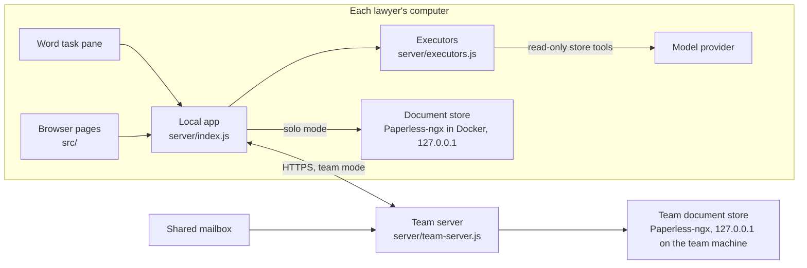

# GinChugger: the app

A contract-review tool for a small in-house legal team, and the reference implementation of its benchmark, GinBench. It reviews a contract in Word against the team's playbook, proposes wording to apply as tracked changes, and keeps the team's documents in a document store (Paperless-ngx, run as a separate local service). This folder is the app. The [repository README](../README.md) explains what it is for and what GinBench shows. GinBench's code lives in `../tough-eval/`; the folder keeps that name until the next benchmark version, because the frozen benchmark's file hashes are keyed on its paths.

No lawyer has validated its output. Findings are a prompt for a lawyer's judgement, not a substitute for it.


Screenshots are in [`docs/screenshots/`](docs/screenshots/): the review, the Inbox, the Library and its search, a document page, the Playbook, Settings, About and Admin. `npm run screenshots` makes them again with the in-memory store, the recorded demo runs (the tests' replay executor) and a test team server (no Docker, no model call); the in-memory store has no preview, so the document page's preview is blank there.

## How it fits together



- `src/` is the React front end: the review screen (also the Word pane, `?host=word`) and the pages (Inbox, Library, the document page, Playbook, Trash, Activity, Settings, Admin, About).
- `server/index.js` is the local app. It serves the pages and the pane on `127.0.0.1`, runs reviews through `server/review.js`, and reads and writes documents through the store. `server/local-guard.js` checks Host, Origin and Sec-Fetch-Site on every request, so a page served from another localhost port cannot call the API; a process running as the same user can, as it can read the data folder.
- `server/store/` is our store interface (decisions 190 and 191). Every screen, the pane and the agent go through it. `paperless.js` talks to Paperless-ngx 3.3.2 over its HTTP API; `fake.js` is an in-memory store for tests; `service.js` starts the store (`store.mode`: managed, external, fake or off). Documents are flat: a counterparty, a type, tags (including "signed", "on hold" and "inbox"), a date, notes, custom fields and full-text search. Paperless keeps the trash, the notes and the history; our rules on top: a signed or on-hold document cannot be trashed, and only an admin sets or lifts a hold. `paperless/docker-compose.yml` is the store's compose file.
- `server/record/` keeps what is not a document, in SQLite (`record.sqlite`): people, keys and setup codes, permissions, playbooks with owners and proposals, clause types and mail bookkeeping. `LocalRecord` in solo mode; `RemoteRecord` talks to the team server in team mode. Review history (which points were applied or dismissed and why) is in `review-history.sqlite`, keyed by store document id.
- `server/store/tools.js` holds the four read-only store tools the model can call during a review or a question (`search_documents`, `list_documents`, `read_document`, `get_counterparty_overview`), with schemas in `server/store/tool-schemas.json`. `server/store-mcp.js` serves them to the Claude CLI over MCP during a review only (per-review token, read-only; there is no MCP access to the store from outside a review, decision 188); it calls the local tools listener (`server/tools-listener.js`), which reads the store as the lawyer named in the token. The API routes call the tools in process. A citation in a finding or an answer is verified only when its quote is an exact substring of that document's text.
- `server/team-server.js` is the team server: playbooks, people, setup codes and keys over HTTPS, the status page, mail capture into the store (`server/mail/`), and the team store's routes for the members' apps, each member acting as their own Paperless user. It reads the same `store` keys from its settings file. It makes no model calls and refuses to start with an AI credential present. In team mode the local app forwards its store requests there and its agent tools read the team store through it (`server/store/remote.js`); Paperless never leaves the team machine's loopback.
- `server/ports/paperless/` holds the code ported from Paperless-ngx, with the originals in `reference/`.
- `bin/gcl.js` is the admin command line: `gcl check`, `backup [dir]`, `restore <dir|file>`, `admin issue-code`, `admin list-codes`, `admin revoke-code`, `admin list-users`, `admin revoke-user` and `mail check`. `scripts/migrate-record-to-paperless.mjs` loads an old `record.sqlite` into the store once (`--retitle` drops file extensions from titles; `--content-keys` sets the "Content key" field on every live `.docx`, so the Library folds copies Word re-saved).

The app files GinBench freezes (`../tough-eval/v2/frozen.json`, tag `bench-v2.0-a`) are `server/review.js`, `server/executors.js`, `server/store/tools.js`, `server/store/text.js`, `shared/compare.js`, `prompts/review.md`, `package.json` and `package-lock.json`. A change to any of them makes a new benchmark version; `node ../tough-eval/v2/check-frozen.mjs` lists what has changed since the tag (on `main` today: `review.js`, `executors.js` and `package.json`). The review's request to the model is unchanged since the tag (same prompt, payload and CLI flags); `tests/review-nonblocking.test.js` pins it.

## Run it

Node.js 22 or later, and Docker running for the document store. [Setup](docs/SETUP.md) goes from a fresh machine to a first review, in the browser and in Word, with troubleshooting.

```sh
npm install
npm run build
npm start           # then Settings · Models: Claude CLI, Anthropic API key or OpenAI-compatible endpoint
```

Open http://localhost:3000. Until a model route works the Review screen says "No model set up yet · Settings · Models", and a Review pressed anyway says so in one line. The app starts the store itself (`docker compose up -d` on `paperless/docker-compose.yml`; the first start pulls about 6.6 GB). **Without Docker** it falls back to the built-in, in-memory store: documents are kept until the app stops, one line on each page says so, and the log says `Document store: built-in, in memory (…)`. With Docker present nothing changes. `GCL_STORE=fake` asks for the in-memory store explicitly.

For Word, the pane must be served over trusted HTTPS on `https://localhost:3443`: `node scripts/setup-word.js`, then [Setup](docs/SETUP.md) step 5 or [Word setup](docs/WORD.md). For a team server, see [the IT page](docs/FOR-IT.md); `node scripts/team-cert.mjs <dir>` makes a throwaway certificate authority and server certificate for trying it.

## Model routes

The local app makes every model call. The browser and the pane never hold a credential. Choose the route on the Settings page, or with `REVIEW_EXECUTOR` (which then overrides the page). The OpenAI-compatible endpoint's address is `OPENAI_BASE_URL` (in `.env`; see `.env.example`).

| Route | What it uses | Whose terms apply |
|---|---|---|
| `claude` | The Claude Code CLI, signed in with the lawyer's own account, unmodified | That plan's terms. Team and Enterprise seats are business terms; Free, Pro and Max are for personal use |
| `anthropic` | The Anthropic Messages API with a key | Anthropic's Commercial Terms |
| `openai` | Any OpenAI-compatible `/chat/completions` endpoint (OpenRouter, Munito, a local model server) | That provider's terms |

Keys entered on the Settings page go to the Mac Keychain or Windows Credential Manager. A key set in the environment when the app starts wins (development). Read your provider's terms before sending client material. None of this is legal advice.

The `claude` route reports "not logged in" when the app is started from a shell an agent or automation spawned. Start it from your own terminal where `claude` is signed in.

Live reviews send the agreement, the comparison version, the playbook's enabled entries, any instruction, and what the model reads from other documents in the store (as tool results, or the counterparty's other documents in a single call) to the chosen route. Set `REVIEW_TRACE_DIR` to keep every call's prompt, payload and raw output.

A review or a question through the `claude`, `anthropic` or `openai` route runs without blocking the app: pages, Ask and progress keep answering while the model works, and Stop beside Reviewing (or Ask's Stop) cancels the request and ends the model call (the CLI child is killed, an API call cancelled). The evaluation-only `codex`, `muse` and `agy` routes still block the app for the length of a call.

## Tests

```sh
REVIEW_EXECUTOR=refuse-live npm test    # unit and integration tests; any live model call fails the test
npm run test:e2e                        # end to end: the built pane, the real server, a fake of Word's API, a real team server
npm run stress                          # stress and click-through harness: seeded clicks, store and model faults
node scripts/verify-submission.js       # SPDX headers, NOTICE entries, nothing private tracked, release checksums
```

The tests that need a model start the app themselves with the replay executor (`REVIEW_EXECUTOR=replay`), which plays recorded runs from `data/recorded-runs/` with no model call; it is test infrastructure, not a mode for users, and Settings lists it only while the environment runs it. The end-to-end tests use an in-page fake of Word's API (`tests/e2e/office-fake.js`). A fake is not Word. The checks a person must still make in real Word, on Windows and against a real mailbox are listed in [`docs/VERIFICATION.md`](docs/VERIFICATION.md).

**The review record.** There is no Export record button since decision 184 (the pane has one job). `POST /api/review-record` still builds the record from a review: the review, the decisions, the document, the earlier version and the playbook, with a SHA-256 of each part. With a record signing key on the Settings page (or `REVIEW_RECORD_SIGNING_KEY` when the app starts) the digest is signed with Ed25519, and `node scripts/verify-record.js review-record.json <public key>` says whether it was changed after signing. The key is handed to the signer directly and never placed in the environment of a CLI the app runs (`tests/local-api.test.js`). What the lawyer did with each point (applied, dismissed and why) is kept per document in the review history (`review-history.sqlite`).

## Release

`node scripts/release/build-mac-pkg.mjs` builds a universal Mac `.pkg` (Node 22 for Apple silicon and Intel, the built app, prebuilt `better-sqlite3` and `@napi-rs/keyring`, a login item) with its SHA-256. `scripts/release/build-win-msi.ps1` builds the Windows `.msi` with WiX Toolset v5. The `Release` workflow builds both on a tag `v<version>`, checks them and makes a draft GitHub release; it also publishes the team-server image. Both installers are unsigned. There is no auto-updater: in team mode the app shows a notice with a link to the matching release when its version and the server's differ.

## Documents

[Setup](docs/SETUP.md) · [For IT and security](docs/FOR-IT.md) · [Word setup](docs/WORD.md) · [Demo script](docs/DEMO.md) · [Verification record](docs/VERIFICATION.md) · [Retention statement template](docs/RETENTION.md) · [Data provenance](docs/DATA.md) · [Finding format](docs/FINDING.md) · [Design system](docs/DESIGN-SYSTEM.md)

The included Common Paper agreements are CC BY 4.0. Every other document in `data/fixtures/` is fictional and written for this project. Licence: GPL-3.0-or-later; ported code and credits are in [`NOTICE.md`](../NOTICE.md).
